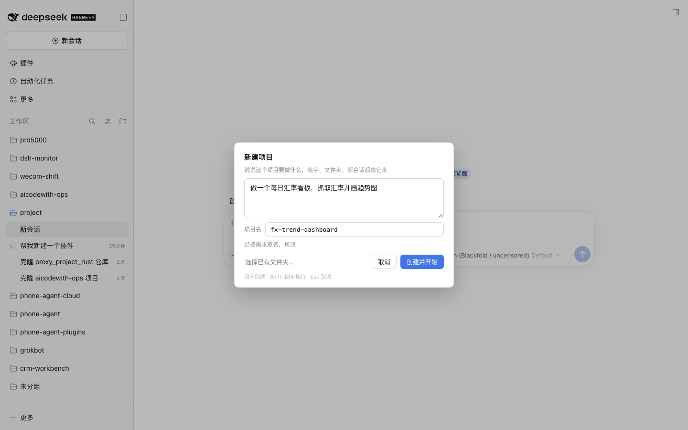

# dsh-quick-project

侧边栏「工作区」右上角的 **+**，现在是一个描述框：**说一句这个项目要做什么，名字由模型取，文件夹建好，新会话开出来，需求已经发出去开始干活。**

原来的路径是：点 + → 目录树里一层层翻到 `~/project` → 新建文件夹 → 返回 → 找出来 → 再把手里的需求重打一遍。这个插件把它压成「打一段话 → 回车」。

## 长什么样



回车之后：文件夹建好、工作区打开、需求已经发出去。


## 用法

| 动作 | 结果 |
|---|---|
| 点「+」，描述需求，回车 | 模型取名（如 `alipay-bill-summary`）→ 在 `~/project/<名字>` 建目录 → 打开工作区 → 新会话里把需求**发出去** |
| 只填「项目名」、不写需求 | 直接建目录并打开空白会话 |
| 名字不满意 | 「项目名」那一栏随时可改，改了就不再被自动覆盖 |
| 输入一个已存在的名字 | 提示「同名文件夹已存在，将直接打开」→ 打开它，需求照样发出 |
| `Esc` / 点遮罩 / 取消 | 关闭，什么都不建 |
| 「选择已有文件夹…」 | 打开应用内目录浏览（面包屑 + 子目录列表），选中即可用；不依赖宿主的原生选择器 |

`Shift+回车` 换行。名称必须是单个路径段：不能为空，不能含 `/` 或 `\`。

## 三层分别在哪

1. **取名**：宿主侧 `host/name-route.mjs`，`POST /quick-project/name`。用默认模型路由（`agentDefaultModel`）问一句，只取名字：答案里优先抓反引号/引号内的候选，再按「连字符数 + 长度」打分，所以模型回一句 "Here you go: `invoice-reconciler`" 也只会得到 `invoice-reconciler`。中文答案会给一个短中文名。模型挂了/路由不通时回 `ok:false`，浏览器侧用本地兜底名，项目照建不误。
2. **建目录 + 开工作区**：浏览器侧。`directoryPicker.createDirectory` 建目录，工作区的登记与打开交给目录流的所有者（`onPicked`）。
3. **把需求发出去**：`startSession(workspaceId, { prompt })` 只**填草稿**不发；`AutoSendGuard` 挂在 `conversation.input.left`，等它自己那个会话的草稿变成刚写进去的文字，再 `inputActions.submit()` 一次。

「选择已有文件夹…」走的是 `listDirectory`（`browse` 能力），**不用** `directoryPicker.pick`：后者需要宿主的 `native` 能力，而用应用内选择器组装的部署只提供 `browse`，调过去会直接报 “needs the native capability”。

## 它接管了什么

Harness 的目录流插槽 `sidebar.workspaces.directoryFlow`（以及空状态那个 `conversation.hero.workspace.directoryFlow`）声明为 `single`，按 priority 升序取第一个渲染。官方目录选择器在 priority `0`，本插件注册在 `**-1**`，所以是它渲染；官方那个仍然活着，通过「选择已有文件夹…」可达。

## 安装

```bash
dsh plugin install github:DaneelOlivaw1/dsh-quick-project#main
```

auto 取名还需要把宿主的取名路由挂上。它单独成模块，是因为 **Node 按 URL 缓存 ESM**：改插件主模块只有重启宿主才生效，而进程没导入过的路径会在 recompose 时被加载。所以在 profile 的 `cordis.patch.yml` 末尾加：

```yaml
- insert:
    - id: quick-project-name
      name: file:///Users/daneel/project/dsh-quick-project/host/name-route.mjs?v=1
```

`?v=1` 是给宿主内部用的版本号：改了 `host/name-route.mjs` 之后把它 +1，再用插件管理器的「禁用→启用」切一次 `quick-project-name`，新代码就会被导入（不 +1 会命中 ESM 缓存，跑的还是旧逻辑）。

## 开发

```bash
node scripts/build.mjs                          # 重建 client/client.js
DSH_QUICK_PROJECT_DEBUG=1 node scripts/build.mjs # 不压缩
node --test test/host.test.mjs                  # 宿主侧：取名路由的契约
```

改 `client/src/client.js` 后必须重建：宿主下发的是 `client/client.js` 这个打包产物。React 保持外置（loader 的 require 表持有它，打进包里会出现第二份副本并破坏 hooks）。

文案在 `client/src/client.js` 顶部的 `LABELS`（zh/en）。项目根目录是宿主 home 下的 `project/`。

## 已知取舍

- 「+」弹出的是对话框，不是常驻在侧栏里的输入框：那一行（搜索/排序/+）官方没有开放 slot，硬塞只能靠 DOM 注入，且 280px 的侧栏塞不下三个图标加输入框。
- 需求发出后模型会立刻开始干活。名字没取好时先改名字再回车，比事后重命名工作区便宜。
